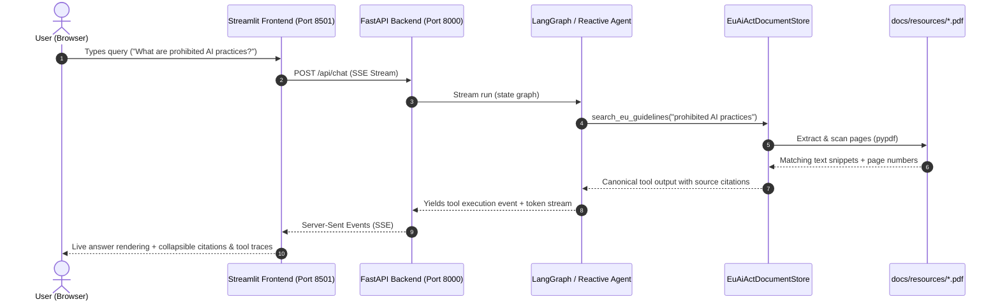

# The 6 GenAI Paradigms Showcase & Reference Guide

This comprehensive guide details the **6 Generative AI Integration Paradigms** implemented in this repository across **Google Gemini**, **OpenAI**, **Anthropic**, and **LangChain** in both **Python** and **TypeScript**, along with the **Decoupled Document Retrieval Agent & Streamlit UI**.

---

## 1. Architectural Matrix: 6 Paradigms Comparison

| # | Paradigm | Google Gemini SDK | OpenAI SDK | Anthropic Claude SDK | LangChain Abstraction (`langchain_suite`) |
|---|---|---|---|---|---|
| **1** | **Unified Chat & Text Generation** | `client.models.generate_content()` (`google-genai`) | `client.chat.completions.create()` / `client.responses.create()` (`openai`) | `client.messages.create()` (`@anthropic-ai/sdk`) | `ChatOpenAI`, `ChatAnthropic`, `ChatGoogleGenerativeAI` via `init_chat_model()` |
| **2** | **Streaming & Tool Calling** | `client.models.generate_content_stream()` with `function_declarations` | SSE chunks (`delta.tool_calls`) with `tools: [{type: "function"}]` | Typed SSE stream (`content_block_start`, `input_json_delta`) | `.stream()` / `.astream()` with `.bind_tools()` emitting structured chunks |
| **3** | **Strict Structured Outputs** | `response_mime_type: "application/json"`, `response_schema: Pydantic/JSONSchema` | `response_format: { type: "json_schema", strict: true }` | Native CFG logit masking (`output_config.format`) or tool-choice schemas | `model.with_structured_output(Schema)` enforcing strict Pydantic v2 / Zod schemas |
| **4** | **Prompt Caching & Cost Optimization** | Explicit context caching via `client.caches.create()` with TTL | Automatic prefix caching for prompts $\ge$ 1,024 tokens | Explicit cache breakpoints via `cache_control: {"type": "ephemeral"}` | Uniform system prompt prefixing; provider-level metadata tracking (`usage_metadata`) |
| **5** | **Batch Processing Pipelines** | Batch prediction via Google Cloud Batch / Gemini Batch API | Asynchronous `/v1/batches` API with JSONL upload and 24h turnaround (50% discount) | Asynchronous `/v1/messages/batches` API with batch orchestration | `Runnable.batch()` and `Runnable.abatch()` with configurable concurrency limits |
| **6** | **Gateways & Resilience** | Multi-model fallback, retry loops, and rate limit backoff | Circuit breaker state machine, fallback cascade, LiteLLM / OpenRouter proxy | Fallback cascade across Haiku $\rightarrow$ Sonnet, cost-aware router | `.with_fallbacks()` cascade, LiteLLM gateway client, OpenRouter integration |

---

## 2. Direct Provider Execution Commands

Each paradigm can be executed directly using native provider SDKs in both Python and TypeScript.

### Paradigm 1: Basic Chat & Multi-Turn Conversations
Demonstrates standard prompt execution, message formatting differences, and multi-turn message histories.

- **Python**:
  ```bash
  cd python
  # Runs OpenAI, Anthropic, and Gemini sequentially:
  python -m src.m01_paradigms.chat_comparison
  ```
- **TypeScript**:
  ```bash
  cd typescript
  npm run start:m01
  ```

### Paradigm 2: Streaming & Tool Calling
Demonstrates Token-by-Token SSE streaming and function calling with schema binding and tool-result round-trips.

- **Python**:
  ```bash
  cd python
  # Streaming comparison across providers:
  python -m src.m01_paradigms.streaming_comparison
  # Tool calling execution loop:
  python -m src.m01_paradigms.tool_calling
  ```
- **TypeScript**:
  ```bash
  cd typescript
  npm run start:m01:stream
  npm run start:m01:tool
  ```

### Paradigm 3: Strict Structured Outputs
Demonstrates deterministic JSON schema enforcement via Context-Free Grammar (CFG) constrained decoding and self-repair fallback loops.

- **Python**:
  ```bash
  cd python
  python -m src.m02_structured_outputs.gemini_structured     # Gemini response_schema
  python -m src.m02_structured_outputs.openai_strict        # OpenAI strict json_schema
  python -m src.m02_structured_outputs.anthropic_structured # Anthropic structured outputs
  python -m src.m02_structured_outputs.self_repair          # Self-healing JSON repair loop
  ```
- **TypeScript**:
  ```bash
  cd typescript
  npm run start:m02:gemini     # Gemini responseSchema with Zod validation
  npm run start:m02            # OpenAI strict JSON schema
  npm run start:m02:anthropic  # Anthropic structured outputs
  npm run start:m02:repair     # Self-repair schema validation
  ```

### Paradigm 4: Prompt Caching & Cache Invalidation
Demonstrates token cost reduction (up to 90% savings) through static prefix caching and cache boundary management.

- **Python**:
  ```bash
  cd python
  python -m src.m03_prompt_caching.cache_invalidation_demo
  python -m src.m03_prompt_caching.anthropic_cache
  python -m src.m03_prompt_caching.gemini_cache
  ```
- **TypeScript**:
  ```bash
  cd typescript
  npm run start:m03
  npm run start:m03:anthropic
  ```

### Paradigm 5: Batch Processing Pipelines
Demonstrates asynchronous non-blocking bulk requests with error isolation and token efficiency.

- **Python**:
  ```bash
  cd python
  python -m src.m04_batch_processing.batch_orchestrator
  ```
- **TypeScript**:
  ```bash
  cd typescript
  npm run start:m04
  ```

### Paradigm 6: Gateways, Circuit Breakers & Fallback Cascades
Demonstrates production resilience: Circuit Breakers (CLOSED $\rightarrow$ OPEN $\rightarrow$ HALF-OPEN), multi-provider fallback cascades, and routing through unified LLM gateways (LiteLLM / OpenRouter).

- **Python**:
  ```bash
  cd python
  python -m src.m05_resilience.circuit_breaker
  python -m src.m05_resilience.fallback_cascade
  python -m src.m06_gateways.cost_calculator
  python -m src.m06_gateways.openrouter_integration
  python -m src.m06_gateways.litellm_proxy_client
  ```
- **TypeScript**:
  ```bash
  cd typescript
  npm run start:m05
  npm run start:m05:fallback
  npm run start:m06
  npm run start:m06:openrouter
  npm run start:m06:litellm
  ```

---

## 3. Unified LangChain Multi-Paradigm CLI Application

The unified LangChain CLI demonstrates all 6 paradigms through provider-agnostic LangChain abstractions. It supports **interactive menus**, **direct command-line flags**, and an **offline mock mode** requiring **zero API keys**.

### Python CLI Runner
- **Command alias**: `lc-cli` (installed via package scripts) or `python -m src.langchain_suite.cli`
- **Interactive Mode**:
  ```bash
  cd python
  python -m src.langchain_suite.cli
  ```
- **Run all paradigms offline in Mock Mode**:
  ```bash
  cd python
  python -m src.langchain_suite.cli --paradigm all --provider mock
  ```
- **Run a specific paradigm with a specific provider**:
  ```bash
  # Paradigm 2 (Tool Calling) with OpenAI:
  python -m src.langchain_suite.cli --paradigm 2 --provider openai

  # Paradigm 3 (Structured Outputs) with Gemini:
  python -m src.langchain_suite.cli --paradigm 3 --provider gemini

  # Paradigm 4 (Prompt Caching) with Anthropic:
  python -m src.langchain_suite.cli --paradigm 4 --provider anthropic

  # Paradigm 5 (Batch Processing) with concurrency 5:
  python -m src.langchain_suite.cli --paradigm 5 --provider mock --concurrency 5
  ```

### TypeScript CLI Runner
- **Command**: `npm run cli:langchain` or `npx tsx src/langchain_suite/cli.ts`
- **Interactive Mode**:
  ```bash
  cd typescript
  npm run cli:langchain
  ```
- **Run all paradigms offline in Mock Mode**:
  ```bash
  cd typescript
  npm run cli:langchain -- all mock
  # or:
  npx tsx src/langchain_suite/cli.ts all mock
  ```
- **Run a specific paradigm**:
  ```bash
  npx tsx src/langchain_suite/cli.ts 2 mock   # Streaming & Tools
  npx tsx src/langchain_suite/cli.ts 3 mock   # Structured Outputs
  npx tsx src/langchain_suite/cli.ts 5 mock   # Batch Inference
  npx tsx src/langchain_suite/cli.ts 6 mock   # Fallback Cascade
  ```

---

## 4. Decoupled Document Retrieval Agent & Streamlit UI

The system includes a production-grade **Decoupled Architecture** featuring a **Streamlit Web Application** connected to an autonomous **FastAPI SSE Backend Agent** for document querying.

### 4.1 Strict Architectural Constraint: Simple Retrieval (NOT RAG)
> [!IMPORTANT]
> This application implements **Simple Retrieval**, strictly **NOT RAG**:
> - **NO Vector Databases**: No ChromaDB, FAISS, Pinecone, or Milvus.
> - **NO Neural Embeddings**: No vector generation, embedding models, or dimension indexing.
> - **NO Cosine Similarity**: No approximate semantic similarity scoring.
> - **Deterministic Lexical / Section Search**: Uses deterministic keyword tokenization, article/chapter extraction, and exact text indexing directly over the official PDF documents in `docs/resources/` using `pypdf`.
> - **Verifiable Citations**: Every retrieved passage includes the exact source document title and 1-based page number.

### 4.2 Decoupled Architecture Diagram



### 4.3 Running the Streamlit Retrieval Application

#### Option A: Unified Launcher (Recommended)
Spawns both the FastAPI backend (port 8000) and the Streamlit frontend (port 8501) concurrently with automatic shutdown:
```bash
cd python
python -m src.langchain_suite.frontend_agent.run_showcase --all
```

#### Option B: Standalone Process Execution
Run backend and frontend in separate terminals:
```bash
# Terminal 1 - Start the FastAPI Agent Backend (Port 8000):
cd python
python -m src.langchain_suite.frontend_agent.run_showcase --backend
# Alternatively: uvicorn src.langchain_suite.frontend_agent.backend.server:app --port 8000 --reload

# Terminal 2 - Start the Streamlit Frontend (Port 8501):
cd python
python -m src.langchain_suite.frontend_agent.run_showcase --webapp
# Alternatively: streamlit run src/langchain_suite/frontend_agent/frontend/app.py --server.port 8501
```

Once launched:
1. Open your browser at `http://localhost:8501`.
2. Inspect the **EU AI Act Document Repository** in the sidebar (viewing loaded documents and total extracted pages).
3. Click any **Quick Question** (e.g., *"What AI practices are strictly prohibited under Article 5?"*, *"What are the transparency obligations for high-risk AI systems?"*, *"What are the maximum penalties for non-compliance?"*).
4. View the **Live SSE Stream**, the **Exact Page Citations**, and expand the **Agent Tool Execution Trace** to inspect the deterministic retrieval calls.

#### Option C: TypeScript Decoupled Web Application
A full TypeScript counterpart is also provided:
```bash
cd typescript
# Launch Express SSE Backend (Port 8000) and Web Client (Port 3000):
npm run start:frontend:all
```

#### Option D: Containerized Stack with Podman & Compose
Both the FastAPI backend and Streamlit frontend are containerized via a multi-stage `Containerfile` and orchestrated with `compose.yaml`.

```bash
# 1. (Optional) Build images explicitly:
podman build --network=host -t agent-backend --target backend -f Containerfile .
podman build --network=host -t agent-frontend --target frontend -f Containerfile .

# 2. Start both services in background:
podman compose up -d

# 3. Verify service health and status:
podman compose ps
curl http://localhost:8000/health
curl http://localhost:8501/_stcore/health

# 4. Stream real-time logs:
podman compose logs -f

# 5. Stop the container stack:
podman compose down
```

> [!NOTE]
> - `compose.yaml` uses `network_mode: host` for zero-overhead, seamless compatibility with Podman on Windows WSL2 and Linux host environments.
> - For environments requiring isolated container bridge networks (e.g. Docker Desktop or production CI/CD), use `compose.bridge.yaml`:
>   ```bash
>   podman compose -f compose.bridge.yaml up -d
>   ```

---


## 5. Verification & Automated Test Commands

All components are covered by comprehensive unit and integration test suites:

| Test Target | Language | Command | Status |
|---|---|---|---|
| **Simple Document Retrieval Store** | Python | `pytest tests/test_document_retrieval.py` | 6/6 Passing |
| **FastAPI Backend & Mock Agent** | Python | `pytest tests/test_frontend_agent.py` | 8/8 Passing |
| **LangChain Multi-Paradigm CLI** | Python | `pytest tests/test_langchain_cli.py` | 8/8 Passing |
| **TypeScript LangChain CLI** | TypeScript | `npm run test:cli` | 7/7 Passing |
| **TypeScript Frontend Agent** | TypeScript | `npm run test:frontend-agent` | 5/5 Passing |
| **TypeScript Gateways & Circuit Breakers** | TypeScript | `npm run test:gateways` | 4/4 Passing |

To run the entire test suite across both stacks:
```bash
# Run all Python tests
cd python
pytest

# Run all TypeScript tests
cd typescript
npm run test:cli
npm run test:frontend-agent
npm run test:gateways
```
