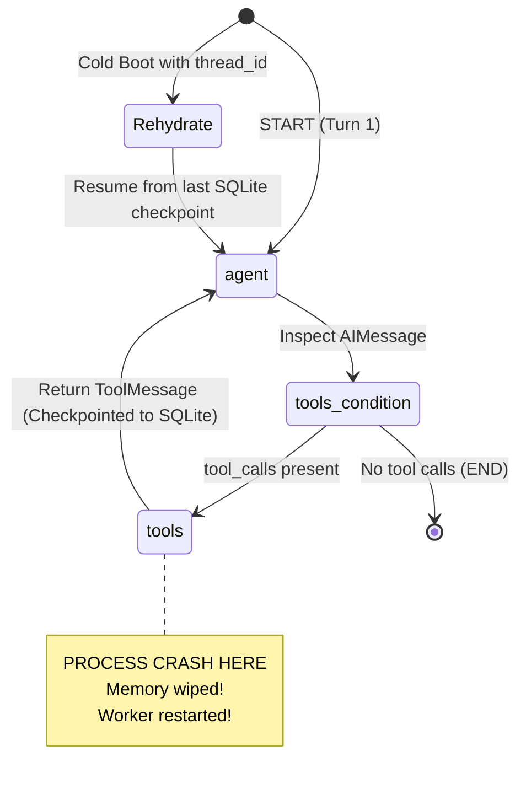

# Lab 05: Fault-Tolerant Agent State Machine & SQLite Crash Recovery

## 🎯 Business Context

In autonomous enterprise operations (such as automated telecom outage triage and credit remediation), multi-step AI agents interact with customers and invoke sensitive external APIs (e.g. CRM queries, cell tower telemetry probes, and billing ledger credits).

When microservice containers restart, workers experience network partition, or unhandled exceptions crash a worker process midway through a workflow:
1. **Naive In-Memory Agents** lose all context, forcing the customer to restart their conversation from scratch.
2. **Duplicate Side Effects**: Restarting from scratch causes the agent to re-execute mutating tools (such as issuing duplicate billing credits or double-booking repair technicians).

In this lab, you will build a production-grade **LangGraph state machine** backed by **SQLite checkpointing**, verify durable state persistence across simulated process destruction, and implement state rehydration and seamless resumption.

---

## 🛠️ Architecture & State Flow



---

## 📋 Your Engineering Tasks

Open the starter file in your language of choice:
- **Python**: [`exercises/lab05_langgraph_recovery/python/starter.py`](./python/starter.py)
- **TypeScript**: [`exercises/lab05_langgraph_recovery/typescript/starter.ts`](./typescript/starter.ts)

Follow the `TODO` markers to:
1. **Define the Typed State Schema**: Set up the append-only message reducer.
2. **Assemble the Cyclical Graph**: Connect `START -> agent`, conditional routing to `tools` or `END`, and the return edge `tools -> agent`.
3. **Attach SQLite Persistence**: Configure `SqliteSaver` to persist state transitions per `thread_id`.
4. **Implement State Rehydration & Resumption**: Inspect and resume interrupted workflows.

---

## 🧪 Running the Automated Verification Tests

### Python Stack (`uv` + `pytest`)
```powershell
cd python
# Run the test suite against your starter implementation (fails until implemented)
uv run pytest ../exercises/lab05_langgraph_recovery/python/test_recovery.py

# Test the reference solution
uv run pytest ../exercises/lab05_langgraph_recovery/python/test_recovery.py -k "solution"
```

### TypeScript Stack (Node.js 24 + `tsx`)
```powershell
cd typescript
# Run the test suite against your starter implementation
npm run test:lab05
```

