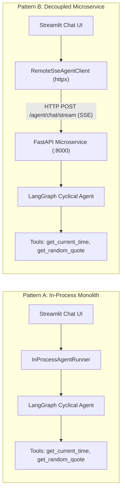

# Streamlit & LangChain Agent Integrations: Dual Architecture Showcase

This module demonstrates how to connect modern **Streamlit** chat frontends to **LangChain & LangGraph** tool-calling agents using two fundamental enterprise architectural patterns:
1. **Pattern A: Monolithic In-Process Agent** (Streamlit runs the agent directly).
2. **Pattern B: Decoupled Agent Microservice** (FastAPI streams lifecycle events to Streamlit over **Server-Sent Events / SSE**).

---

## 🏗️ Architecture Comparison



| Evaluation Vector | Pattern A: In-Process Monolith | Pattern B: Decoupled Microservice (FastAPI + SSE) |
| :--- | :--- | :--- |
| **Setup & Complexity** | Zero-configuration (`streamlit run`) | Requires 2 processes (API server + UI client) |
| **UI Lifecycle Shielding** | Script re-executes on every user input; requires thread-safe queue & loop shielding | UI is pure presentation; backend maintains clean, isolated agent execution |
| **Scalability** | Tied directly to Streamlit WebSocket sessions | Horizontal backend scaling (behind ALB, K8s, or API Gateway) |
| **Multi-Client Support** | Streamlit only | Same SSE API serves React/Next.js, Slack bots, CLI, and mobile apps |
| **Failure Blast Radius** | Monolithic: LLM timeout or unhandled exception halts UI | Decoupled: Frontend catches connection drops and renders retry states |

---

## 🛠️ Extensible Tool Registry (V1)

Tools are defined via LangChain's `@tool` decorator in [`tools/default_tools.py`](file:///c:/Users/PantelisNasikas/workspace/genai_agents_api/telekom_courses/advanced_ai_integration/python/src/langchain_suite/frontend_agent/tools/default_tools.py):

1. **`get_current_time(timezone: str = "UTC")`**:
   - Timezone-aware date/time lookup using Python's standard `zoneinfo.ZoneInfo`.
   - Supports `"UTC"`, `"Europe/Berlin"`, `"America/New_York"`, `"Asia/Tokyo"`, `"Europe/Athens"`, etc.
   - Gracefully falls back to UTC if an invalid timezone is supplied.

2. **`get_random_quote(category: str = "general")`**:
   - Curated repository of inspirational and philosophical quotes.
   - Categories: `"technology"`, `"philosophy"`, `"motivation"`, `"science"`, or `"general"`.

### Adding a New Domain Tool
To add a new tool (e.g. database query, weather, calculator), simply decorate your function and register it with `GLOBAL_TOOL_REGISTRY`:

```python
from langchain_core.tools import tool
from src.langchain_suite.frontend_agent.tools.registry import GLOBAL_TOOL_REGISTRY

@tool
def check_order_status(order_id: str) -> str:
    """Check the real-time shipping status for a customer order."""
    return f"Order {order_id} is in transit with DHL."

GLOBAL_TOOL_REGISTRY.register(check_order_status)
```
The tool will automatically appear in the Streamlit tool inspector and become available to both in-process and remote agents without modifying UI or server code!

---

## 📡 Server-Sent Events (SSE) Wire Protocol

The FastAPI server exposes `POST /agent/chat/stream`, which transmits typed events using standard SSE format (`text/event-stream`):

```http
POST /agent/chat/stream HTTP/1.1
Host: localhost:8000
Content-Type: application/json

{
  "prompt": "What time is it in Berlin and give me a quote on code",
  "provider": "mock",
  "thread_id": "session-101"
}
```

### Event Stream Chunks:
```
event: tool_start
data: {"event": "tool_start", "tool": "get_current_time", "input": {"timezone": "Europe/Berlin"}}

event: tool_end
data: {"event": "tool_end", "tool": "get_current_time", "output": "Current Time in Europe/Berlin: 2026-10-10 21:12:43 CEST"}

event: token
data: {"event": "token", "content": "The current time in Berlin is..."}

event: done
data: {"event": "done", "status": "completed"}
```

---

## 🚀 How to Run

### Method 1: Using the Unified Showcase Launcher
Run both FastAPI and Streamlit concurrently:
```powershell
cd python
uv run python -m src.langchain_suite.frontend_agent.run_showcase --all
```

Or run either service individually:
```powershell
# Run backend only (port 8000)
uv run python -m src.langchain_suite.frontend_agent.run_showcase --backend

# Run frontend only (port 8501)
uv run python -m src.langchain_suite.frontend_agent.run_showcase --frontend
```

---

### Method 2: Manual Terminal Execution

#### Pattern A (Monolithic In-Process):
```powershell
cd python
uv run streamlit run src/langchain_suite/frontend_agent/frontend/app.py
```
*In the sidebar, keep "Pattern A: In-Process Monolith (Local)" selected.*

#### Pattern B (Decoupled Microservice via SSE):
**Terminal 1 (Backend Agent Microservice):**
```powershell
cd python
uv run uvicorn src.langchain_suite.frontend_agent.backend.server:app --port 8000 --reload
```

**Terminal 2 (Streamlit Frontend):**
```powershell
cd python
uv run streamlit run src/langchain_suite/frontend_agent/frontend/app.py
```
*In the sidebar, switch the radio button to "Pattern B: Decoupled Backend (FastAPI + SSE)".*

---

## 🧪 Running Automated Tests

Run the test suite verifying tools, agent lifecycle events, FastAPI SSE endpoints, and Streamlit clients:

```powershell
cd python
uv run pytest tests/test_frontend_agent.py
```

