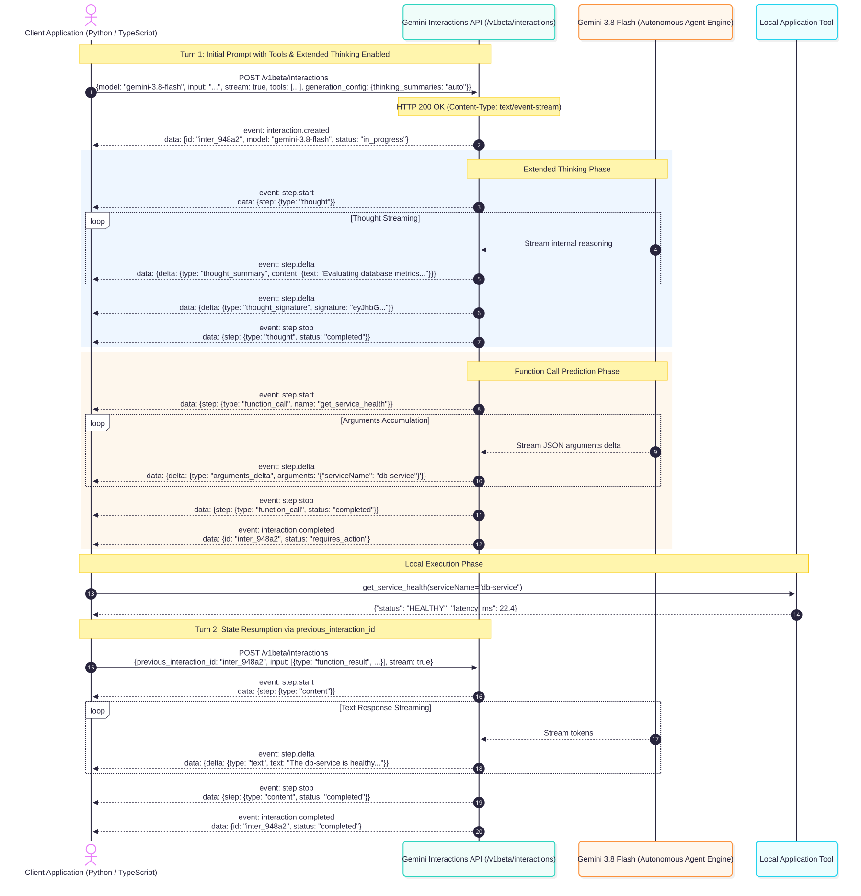

# Module 1: The Modern GenAI API Landscape
## Wire Protocols, SDK Architecture & Mental Models

**Google Gemini • OpenAI • Anthropic**

- Wire formats, message hierarchies & polymorphism
- Extended thinking & reasoning token accounting
- SSE streaming & usage chunk mechanics
- Multi-turn tool calling wire exchanges
- Production resilience & rate limiting

---

# 1. The Fundamental Mental Model

Building production systems with GenAI APIs is **not** simple REST CRUD:

- **Autoregressive Generation**: Payloads are processed as token sequences; output size is dynamic and non-deterministic.
- **Stateless by Design**: Model endpoints do not store session context. State, conversation history, tool definitions, and system prompts must be serialized on every round-trip.
- **Probabilistic Compute vs Deterministic SLAs**: Network latency is tied directly to generated token count, not network bandwidth.
- **Divergent Wire Protocols**: No unified standard exists across OpenAI, Anthropic, and Google.

---

# 2. Message Structures & Roles Compared

```
OPENAI                        ANTHROPIC                    GOOGLE GEMINI
┌───────────────────────┐     ┌───────────────────────┐    ┌───────────────────────┐
│ developer / system    │     │ system (top-level)    │    │ system_instruction    │
├───────────────────────┤     ├───────────────────────┤    ├───────────────────────┤
│ user                  │     │ user [content blocks] │    │ user [parts]          │
├───────────────────────┤     ├───────────────────────┤    ├───────────────────────┤
│ assistant             │     │ assistant             │    │ model [parts]         │
├───────────────────────┤     ├───────────────────────┤    └───────────────────────┘
│ tool (response)       │     │ mid-turn system*      │
└───────────────────────┘     └───────────────────────┘
```

- **OpenAI**: Messages array contains all turns (`developer`, `user`, `assistant`, `tool`). Newer reasoning models use `developer` instead of `system`.
- **Anthropic**: `system` is typically a top-level parameter; `messages` contains `user` and `assistant`. *Claude 5.x / 5.5 / Fable / Mythos also support **mid-conversation system messages** (`role: "system"`) without busting the prompt cache!
- **Sampling & Prefill Rules**: On Claude 4.7+ and Claude 5.x, sampling parameters (`temperature`, `top_p`, `top_k`) are **not supported** (return HTTP 400). Response prefilling (`assistant` turn last) is **not supported** on Claude 4.6+ (returns HTTP 400).
- **Google Gemini**: Uses `user` and `model` roles inside `contents`; system instructions configured via `system_instruction`.

---

# 3. Content Block Polymorphism

Modern APIs treat messages not as raw strings, but as **typed arrays of content blocks**:

```json
// Anthropic Content Block Polymorphism
{
  "role": "user",
  "content": [
    { "type": "text", "text": "Analyze this operational trace and cited documentation:" },
    { "type": "document", "source": { "type": "text", "media_type": "text/plain", "data": "..." }, "title": "Runbook", "citations": {"enabled": true} },
    { "type": "image", "source": { "type": "base64", "media_type": "image/png", "data": "..." } }
  ]
}
```

- **Anthropic Content Blocks**: `text`, `image`, `document` (native citations for text, PDF, and custom content), `thinking`, `redacted_thinking`, `tool_use`, and `tool_result`.
- **Gemini Parts**: Polymorphic `parts` array (`text`, `inline_data`, `function_call`, `function_response`).
- **Interleaved Modalities**: Multi-turn dialogue can seamlessly interleave text, high-resolution diagrams, PDFs, and tool results.
- **First-Class Invocations**: Tool calls and tool returns are typed blocks within the conversation history, not out-of-band payloads.

---

# 4. Reasoning & Extended Thinking Tokens

Frontier reasoning models generate internal chain-of-thought tokens before returning the visible response:

| Dimension | OpenAI (`gpt-6-astra`, `gpt-6.1-sol`, `gpt-6-luna`) | Anthropic (`claude-opus-5-5`, `claude-sonnet-5-5`, `claude-haiku-5-5`) | Google Gemini (`gemini-3.8-flash`, `gemini-3.8-live-extended-thinking`) |
| :--- | :--- | :--- | :--- |
| **API Parameter** | Responses API: `reasoning={"effort": "low"\|"medium"\|"high", "summary": "auto"}` or Chat: `reasoning_effort` | `output_config={"effort": "low" \| "medium" \| "high" \| "xhigh" \| "max"}` | `thinking_summaries: "auto"` (Interactions) or `thinking_budget: N` |
| **Effort Defaults** | `"medium"` default; configurable per prompt | Opus 5.5 & Haiku 5.5 default to `"medium"`; others default to `"high"`. | Configurable per model tier |
| **Sampling Constraint** | Temperature fixed at `1.0` (or omitted) for reasoning models | `temperature`, `top_p`, `top_k` **forbidden** on Claude 4.7+/5.x (HTTP 400) | Varies by mode |
| **Token Visibility**| Responses API: streaming `phase: "commentary"` & `reasoning.delta`; `reasoning_tokens` | Visible `thinking` content block with signature; streaming `thinking_delta` | Streaming `thought_summary` deltas with cryptographic `thought_signature` |
| **Billing Rule** | **Billed as completion/output tokens** | **Billed as output tokens** | **Billed as output tokens** |
| **Turn Continuity** | Responses API: `previous_response_id` or `context: "all_turns"` | **Must preserve thinking blocks** in assistant turn; dynamic effort via system messages | Resumed via `previous_interaction_id` or preserved in contents |

---

# 5. Streaming Mechanics: SSE Paradigms

Providers stream partial generation over **Server-Sent Events (SSE)** via HTTP/2:

- **OpenAI Dual Paradigms**:
  1. **Responses API (`client.responses.create(stream=True)`)**:
     - Typed SSE lifecycle events: `response.created` -> `reasoning.delta` (`phase: "commentary"`) -> `reasoning.completed` -> `content.delta` (`phase: "final_answer"`) -> `response.completed`.
     - Direct token usage telemetry in final event with `reasoning_tokens` breakdown.
  2. **Chat Completions API (`client.chat.completions.create(stream=True)`)**:
     - Emits `ChatCompletionChunk` (`choices[0].delta.content`).
     - Pass `stream_options: {"include_usage": true}` to receive final token usage.
- **Anthropic**: Typed SSE event stream:
  - `message_start` (initial metadata)
  - `content_block_start` (`type: "text"` or `type: "thinking"`)
  - `content_block_delta` (`text_delta`, `input_json_delta`, `thinking_delta`, `signature_delta`)
  - `content_block_stop`, `message_delta` (stop reasons & cumulative usage), `message_stop`
- **Google Gemini Dual Paradigms**:
  1. **Content Generation**: `client.models.generate_content_stream()` emitting `GenerateContentResponse` chunks.
  2. **Interactions API**: `client.interactions.create(stream=True)` emitting typed lifecycle SSE events (`step.start`, `step.delta`, `step.stop`, `interaction.completed`).

---

# 6. Gemini Interactions API Architecture & Lifecycle

Google's stateful **Interactions API** unifies reasoning, streaming, and tool execution:



- **Server-Side State**: Session state maintained remotely; resume anytime with `previous_interaction_id`.
- **Thought Summaries**: Transparent chain-of-thought streaming via `thought_summary` deltas.
- **Function Suspension**: Interaction pauses with `status: "requires_action"`, ready for client execution.

---

# 7. Tool Calling: Declarations & Schemas

| Dimension | OpenAI | Anthropic | Google Gemini (`gemini-3.8-flash`) |
| :--- | :--- | :--- | :--- |
| **Tool Declaration** | `tools: [{type: "function", function: {...}}]` | `tools: [{name: "...", input_schema: {...}}]` | `tools: [{function_declarations: [...]}]` |
| **Strict Schema** | `"strict": true` (enforces logit masking) | `"strict": true` on tool declaration (`additionalProperties: false` required; grammar cached 24h) | Enforced via schema compiler |
| **SDK Automation** | Manual execution loop or Responses configuration | Manual execution loop | Automatic tool execution in `google-genai` or server state via Interactions API |
| **Forced Calling** | `tool_choice: "required"` or `{"name": "..."}` | `tool_choice: {"type": "tool", "name": "..."}` or `{"type": "any"}` | `tool_config: {mode: "ANY"}` |

---

# 8. Tool Calling: Wire Exchange Round-Trip

```
1. Model requests tool execution:
   OpenAI    -> choice.message.tool_calls: [{id: "call_1", function: {name: "get_health", arguments: "..."}}]
   Anthropic -> content: [{type: "thinking", ...}, {type: "tool_use", id: "toolu_1", name: "get_health", input: {...}}]
   Gemini CG -> candidates[0].content.parts: [{function_call: {name: "get_health", args: {...}}}]
   Gemini IA -> interaction.status == "requires_action", step.delta (type: "arguments_delta")

2. Application client sends tool result back:
   OpenAI    -> {role: "tool", tool_call_id: "call_1", content: json_str}
   Anthropic -> {role: "user", content: [{type: "tool_result", tool_use_id: "toolu_1", content: json_str}]}
   Gemini CG -> {role: "user", parts: [{function_response: {name: "get_health", response: {result: ...}}}]}
   Gemini IA -> client.interactions.create(previous_interaction_id=id, input=[{function_result: ...}])
```

---

# 9. Prompt Caching & Memory Reuse

| Dimension | OpenAI (`gpt-6.1-sol`, `gpt-4.1`) | Anthropic (`claude-sonnet-5-5`) | Google Gemini (`gemini-2.5-pro`) |
| :--- | :--- | :--- | :--- |
| **Mechanism** | Explicit (`prompt_cache_options.mode: "explicit"`) + Implicit prefix | Explicit breakpoints (`cache_control`) | Explicit context cache & implicit caching |
| **Threshold** | 1,024 tokens min (128-token incremental chunks) | 1,024 tokens (Sonnet/Opus), 2,048 (Haiku) | 32,768 tokens (explicit cache resource) |
| **Read Discount** | **90% discount** (0.1x; 95% on `gpt-6.1-sol`) / 50% on `gpt-4.1` | **90% discount** (0.1x; 95% on 5.5) | **75% discount** (0.25x) |
| **Write Surcharge**| **1.25x write rate** on explicit cache write (or standard 1.0x) | **1.25x** (5m TTL) or **2.0x** (1h TTL) | Hourly storage fee per million tokens |
| **Telemetry Key** | `usage.prompt_tokens_details.cached_tokens` | `usage.cache_read_input_tokens` | `usage_metadata.cached_content_token_count` |

---

# 10. Rate Limiting, Telemetry & Resilience

Enterprise providers enforce multi-tiered concurrency and throughput limits:

```
Provider HTTP Headers:
- OpenAI:    x-ratelimit-remaining-tokens, x-ratelimit-reset-tokens, retry-after
- Anthropic: anthropic-ratelimit-tokens-remaining, anthropic-ratelimit-requests-remaining, retry-after
- Gemini:    Standard Cloud Quota headers, retry-after on HTTP 429
```

**Dual-Layer Resilience Strategy**:
1. **Client-Side Token Bucket**: Smooths spikes proactively before hitting upstream gateways.
2. **Error Code Discrimination**: Differentiate `slow_down` (429 rate limit exceeded) from `server_is_overloaded` (503 capacity shortage).
3. **Decorrelated Jitter Backoff**: $T_{next} = \min(T_{max}, \text{Uniform}(T_{base}, T_{prev} \times 3))$. Prevents thundering herds.

---

# 11. Key Takeaways for Senior Engineers

1. **Leverage Modern Model Tiers**: Default to `gpt-6.1-sol` / `gpt-6-astra` for deep reasoning, and `gpt-4.1` / `gpt-4.1-mini` for fast high-throughput tasks.
2. **Choose the Right API Paradigm**: Use **Responses API** (`client.responses.create`) for reasoning chains and explicit caching; use **Chat Completions** for simple chat and Predicted Outputs.
3. **Respect Sampling Restrictions**: Do not pass `temperature` or `top_p` to reasoning models; configure reasoning via `reasoning.effort` or `output_config.effort`.
4. **Preserve Thinking & Tool History**: In multi-turn reasoning loops, never mutate or strip assistant thinking or tool call blocks (preserve cryptographic signatures or pass `previous_response_id`).
5. **Optimize Latency Proactively**: Combine Fast Mode (`service_tier: "fast"`), Predicted Outputs, and Prompt Caching to achieve sub-second generation SLAs.

---

# 12. Authoritative References & Official Docs

- **OpenAI Official Guides**:
  - [Responses API & Models](https://developers.openai.com/api/docs/guides/models)
  - [Reasoning Models & Effort](https://developers.openai.com/api/docs/guides/reasoning)
  - [Predicted Outputs](https://developers.openai.com/api/docs/guides/predicted-outputs)
  - [Latency Optimization Guide](https://developers.openai.com/api/docs/guides/latency-optimization)
  - [Fast Mode Processing](https://developers.openai.com/api/docs/guides/fast-mode)
  - [Prompt Caching Guide](https://developers.openai.com/api/docs/guides/prompt-caching)
  - [Rate Limits & Tiers](https://developers.openai.com/api/docs/guides/rate-limits)
  - [Batch API Guide](https://developers.openai.com/api/docs/guides/batch)
  - [Flex Processing](https://developers.openai.com/api/docs/guides/flex-processing)
- **Anthropic Official Documentation**:
  - [Working with Messages](https://platform.claude.com/docs/en/build-with-claude/working-with-messages) • [Streaming & SSE](https://platform.claude.com/docs/en/build-with-claude/streaming) • [Effort & Reasoning](https://platform.claude.com/docs/en/build-with-claude/effort)
- **Google Gemini Documentation**:
  - [Gemini Models Guide](https://ai.google.dev/gemini-api/docs/models) • [Interactions API Overview](https://ai.google.dev/gemini-api/docs/interactions-overview)
